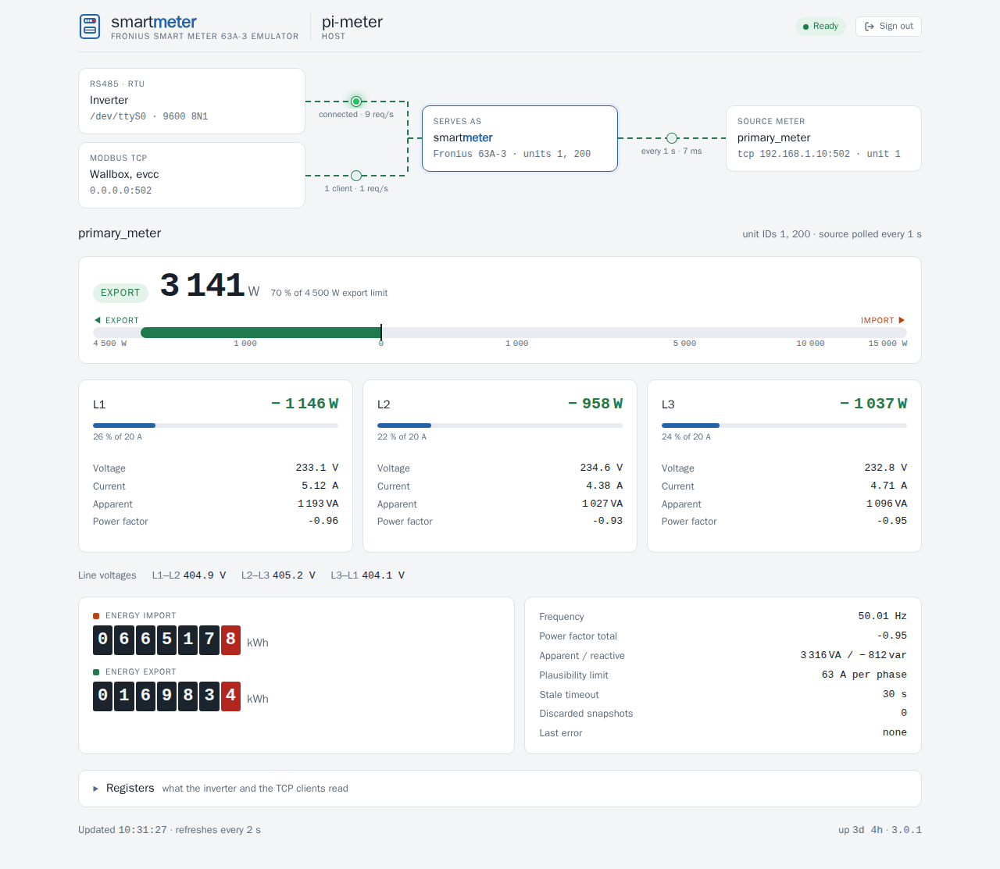

# smartmeter – Deutsche Kurzfassung

🇬🇧 [Full documentation in English](README.md)

  

**smartmeter macht aus einem beliebigen Modbus-Energiezähler einen Fronius Smart Meter – für den
Wechselrichter über RS485 und für Wallboxen über TCP.**

Ein Fronius-Wechselrichter akzeptiert am Zählereingang nur einen Fronius Smart Meter. Misst bereits
ein anderes Gerät den Netzanschluss – ein Smartfox, ein Energiemanager, ein beliebiger Zähler mit
Modbus –, liest smartmeter dieses Gerät aus und **antwortet als Fronius Smart Meter 63A-3**:

- über **RS485 (Modbus RTU)**, Unit-ID 1, mit der proprietären Registertabelle, die der
  Wechselrichter abfragt,
- über **Modbus TCP**, Unit-ID 200, mit dem **SunSpec**-Zählerblock (Modell 203) für Wallboxen,
  evcc und andere Fronius-kompatible Abnehmer.

Der Quellzähler wird einmal pro Intervall gelesen und unter allen Unit-IDs und auf beiden Wegen
gleichzeitig bereitgestellt. Unplausible Werte (Spikes) werden verworfen, die letzten gültigen
Werte bleiben stehen. Liefert die Quelle länger als `staleTimeout` (30 s) keine gültigen Werte,
antworten die Unit-IDs nicht mehr: Der Wechselrichter erkennt einen Zählerausfall, statt mit
eingefrorenen Werten zu regeln. Bricht die Verbindung zur Quelle ab, verbindet smartmeter beim
nächsten Abfrageintervall selbst neu.

Unter `https://<dein-pi>:8443/` zeigt eine Web-Seite Energiefluss, Leistung, Phasen, Zählerstände
und die ausgelieferten Register; sie ist im Programm enthalten und braucht kein Internet. Die
**HTTPS-REST-API** (TLS 1.3) verlangt einen eigenen Token je Aufrufer; smartmeter speichert davon
nur den SHA-256-Hash und schreibt ins Log, wer zugreift.

## In fünf Schritten

1. **Herunterladen:** Das Archiv für deinen Pi gibt es unter
   [Releases](https://github.com/womat/smartmeter/releases/latest): `armv6` für Pi 1 und Zero,
   `armv7` für 32-Bit-Systeme, `arm64` für 64-Bit-Systeme.
2. **Installieren:** System-User `smartmeter` (Gruppe `dialout` für die serielle Schnittstelle)
   anlegen, Programm und `config.yaml` nach `/opt/smartmeter` kopieren, Zertifikat erzeugen.
   Alles gehört root, der Dienst darf `etc/` nur lesen – wer Konfiguration oder Token-Datei
   schreiben kann, kann sich selbst einen Token eintragen.
3. **Konfigurieren:** `env: prod`, serielle Schnittstelle des RS485-Adapters und Adresse des
   Quellzählers samt Registerzuordnung. Dann je Aufrufer einen Token anlegen, z. B.
   `sudo /opt/smartmeter/bin/smartmeter token add browser`; er wird nur dieses eine Mal
   angezeigt, siehe [Tokens](README.md#tokens).
4. **Anschließen:** RS485-Adapter an den Zählereingang des Wechselrichters (D+ an D+, D− an D−,
   Abschluss 120 Ω); im Wechselrichter einen Fronius Smart Meter auf Modbus RTU, Adresse 1,
   9600 Baud einstellen. Am Raspberry Pi die UART `/dev/ttyS0` verwenden und
   `interFrameDelay: 20ms` aus der Beispiel-Config übernehmen, sonst kommen einzelne Anfragen
   zerteilt an.
5. **Starten:** mit der Unit aus dem Archiv (`contrib/smartmeter.service`, läuft abgeschottet),
   dann `https://<dein-pi>:8443/` im Browser öffnen und den Token eingeben.

**Von 3.x auf 4.0.0:** `apiKey` gibt es nicht mehr, stattdessen `tokenFile` und
`smartmeter token add`; HTTPS nur noch mit TLS 1.3, `/ready` ist entfallen. Die Schritte stehen
unter [Upgrading to 4.0.0](README.md#upgrading-to-400).

Die genauen Befehle stehen im [Quick start](README.md#quick-start), alle Einstellungen unter
[Configuration](README.md#configuration), die Herkunft der Registertabellen unter
[Register maps](README.md#register-maps).

## Hinweis

smartmeter ist ein unabhängiges Projekt und steht in keiner Verbindung zur Fronius International
GmbH. Der Wechselrichter regelt mit den Werten des Zählers, etwa die dynamische
Einspeisebegrenzung. Falsch konfigurierte Werte führen zu falschen Regelentscheidungen – vor dem
Einsatz die Werte mit dem Quellzähler und dem Webinterface des Wechselrichters vergleichen.

## Lizenz

MIT, siehe [`LICENSE`](LICENSE).
